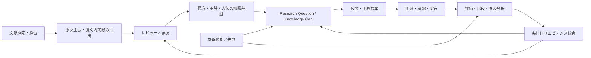

# 深層学習研究知識・実装・実験・分析プラットフォーム：統合論理データモデル

- **性質**：概念／論理データモデルの設計案。SQL実装、API実装、研究結果の妥当性検証は未実施。
- **正本**：本ファイルを統合仕様とし、一次概念は `../catalog/`、コアERの説明は `../ontology/03_core_ontology_reference.md`、実験モデルは `../experiments/04_experiment_model_reference.md` に定義する。
- **対象**：2020–2026年の深層学習研究全般。最初の実験実装は特定ドメインのタスクなど、対象タスクに限定してよい。

## 0. 決定済みの方針（会話で合意した4点）

1. **対象分野**：概念・手法・文献知識は深層学習全般。実験・運用の初期ユースケースは特定ドメインのタスクなど限定した範囲から開始。
2. **論文の粒度**：論文単位の要約だけでなく、**個別主張、論文内の実験、比較群、実験条件、スライス、測定値、失敗／限界**を区別し、研究知識と自前の実験を比較できる粒度を目指す。
3. **知識の更新**：LLMによる探索・候補抽出・対応付けは自動化できる。ただし**正本の概念・主張・関係・統合判断への反映はレビュー承認制**。未承認候補は正本と物理的・論理的に分離。
4. **実行の自動化**：探索、実験案・比較計画の提示までは自動化候補。**GPUジョブ起動、データ改変、知識の確定などの影響を伴う操作は承認ゲート経由**。権限・予算を別に検証する。

## 1. 最初に理解する：不変な一次要素と研究サイクル

### 1.1 一次要素とビュー

**知識の最小の参照対象は `CONCEPT`（概念）**。初期カタログの215項目（Data Scarcity、Overfitting等）は原則それぞれ独立の概念であり、分類の変更で別概念にならない。初期概念のUUIDと定義は `../catalog/concepts.yaml` に、正式な分類所属は `../catalog/concept_topic_assignments.yaml` に収録する。技術分野別20領域は `TOPIC_AREA`／`CONCEPT_TOPIC_ASSIGNMENT` で構成する**分類ビュー**である。

一方、すべての概念が「課題」という同種のオブジェクトとは限らない。概念には状態、失敗現象、機構、制約等が混在してよい。これらが別の概念に対して「原因」「結果」のどちらに当たるかは、独立した `CLAIM` とその型付き関係で管理する。

**さらに、一次概念と同じ意味で重要な基礎エンティティは `METHOD`（手法）、`METRIC`（指標）、`REQUIREMENT`（要求）、`CONTEXT`（条件）。** これらは「すべてが課題概念」という誤った一元化を避けるため、識別上は分離する。上位の統合検索は参照で行う。

| エンティティ | 1行が意味すること | 変化した場合 |
|---|---|---|
| `CONCEPT` | 1つの明確に定義された概念（例：Overfitting） | 表記訂正はrevision、意味の変更は新ID＋対応履歴 |
| `TOPIC_AREA` | 1つの分類カテゴリ（例：汎化） | カテゴリの版・所属を更新、ConceptのIDは不変 |
| `PROBLEM` | 特定条件・要求における具体的な問題 | 条件や観測の版を追加 |
| `CLAIM` | 真偽・成立範囲が検討できる正規化された命題 | 新たな根拠や改訂を履歴追加 |
| `SOURCE_ASSERTION` | 特定の論文の特定版に、著者が実際に書いた、**レビュー済み**の個別主張 | 書誌版・原文位置と共に不変。候補は別のステージングに保存 |
| `PAPER_RESULT` | 論文の特定実験群・条件・スライスにおける1測定結果 | 誤抽出の修正は候補／レビュー履歴で管理 |
| `METHOD` | 抽象的な方法・アルゴリズム（例：DANN） | 方法仕様は版管理、別アルゴリズムなら別ID |
| `IMPLEMENTATION_VERSION` | 特定コード・依存関係・設定の不変スナップショット | コミット変更等は新ID |
| `EXPERIMENT_RUN` | 学習・推論・分析の一回の実行 | 再実行は別Run |
| `EVALUATION` | モデル・評価データ・プロトコルを固定した1評価 | 条件変更は別Evaluation |
| `METRIC_RESULT` | 1評価スライス×1指標定義の測定値 | 計算仕様変更は別結果 |
| `EVIDENCE` | 主張の検討に使う根拠への型付き参照 | 根拠の追加・撤回は履歴追加 |

> **区別**：論文の著者が言ったこと（`SOURCE_ASSERTION`）≠ 知識ベースで同定した一般的な主張（`CLAIM`）≠ 個別の測定値（`PAPER_RESULT`／`METRIC_RESULT`）≠ 個別ラインでの問題（`PROBLEM`）。

### 1.2 全体フロー

`EVIDENCE`を経由した知識統合は自動確定ではない。「測定で差が出た」と「その要因が因果的に証明された」は別の主張として保持する。

## 2. サブドメインと境界（責務分離）

| サブドメイン | 主要エンティティ | 正本の所在（提案） | 主責務 |
|---|---|---|---|
| A. 概念・分類 | `CONCEPT`, `CONCEPT_REVISION`, `TOPIC_AREA`, `CONCEPT_TOPIC_ASSIGNMENT`, `VIEW_DEFINITION` | PostgreSQL | 不変ID、意味、同義語、分類版 |
| B. 文献収集 | `PUBLICATION`, `DOCUMENT_VERSION`, `LITERATURE_SEARCH`, `SEARCH_HIT`, `SCREENING_DECISION` | PostgreSQL＋文書ストレージ | 文献・検索・採否・版の来歴 |
| C. 原文の知見 | `SOURCE_EXCERPT`, `EXTRACTION_CANDIDATE`, `SOURCE_ASSERTION`, `PAPER_EXPERIMENT`, `PAPER_ARM`, `PAPER_RESULT` | PostgreSQL | 論文中の主張・実験条件・数値の細分化 |
| D. 方法と実装 | `METHOD`, `METHOD_VERSION`, `IMPLEMENTATION_VERSION`, `RUN_METHOD_USAGE` | PostgreSQL＋Git | 論文的方法とコード・設定の対応 |
| E. 実験・評価 | `STUDY`, `HYPOTHESIS`, `EXPERIMENT_PLAN`, `EXPERIMENT_RUN`, `EVALUATION`, `METRIC_RESULT`, `ANALYSIS` | PostgreSQL＋MLflow＋ファイル | 実行と測定、比較可能性、再現性 |
| F. 知識・根拠の統合 | `CLAIM`, `CLAIM_EVIDENCE`, `APPLICABILITY_PROFILE`, `EVIDENCE_SYNTHESIS`, `CLAIM_CONFLICT` | PostgreSQL | 条件付き関係、反証、統合判断 |
| G. 研究計画 | `RESEARCH_QUESTION`, `KNOWLEDGE_GAP`, `EXPERIMENT_PROPOSAL`, `RESEARCH_DECISION` | PostgreSQL | 次に調査・検証する価値の判断 |
| H. ガバナンス | `KNOWLEDGE_PROPOSAL`, `REVIEW_DECISION`, `EXECUTION_REQUEST`, `EXECUTION_APPROVAL`, `AUDIT_EVENT` | PostgreSQL | 自動抽出と承認済み知識の分離、操作監査 |
| I. 失敗・本番（段階追加） | `FAILURE_CASE`, `FAILURE_CLUSTER`, `ERROR_ANALYSIS`, `OBSERVATION` | PostgreSQL＋Parquet | 失敗サンプルの再利用と原因仮説 |

**重要**：文献の測定値と内製の `METRIC_RESULT` は別レコードを正本とする。数値・指標仕様・サンプル情報が十分に一致する場合に限り、統一された比較ビューに正規化する。論文の表に掲載された値を「自社Runで測定した値」として捏造してはならない。

## 3. 論理データモデル

表中のIDは論理的な型。新規にスキーマを構築する際はすべてのFKについて参照先型を一致させる。`?`はNULL可、`UQ`は一意制約候補を表す。

### 3.1 概念ID、分類、適用条件

| テーブル | 主要列 | 整合性・意図 |
|---|---|---|
| `CONCEPT` | `concept_id UUID PK`, `canonical_name`, `definition`, `kind_code`, status | **分類非依存のID**。意味を別概念にする更新は禁止 |
| `CONCEPT_REVISION` | concept_id, revision_no, snapshot, reason | 字句修正・説明の更新履歴。意味変更は新概念と `CONCEPT_SUPERSESSION` |
| `TOPIC_AREA_VERSION` | `topic_version_id`, `area_id`, name, valid_from, valid_to | 分類カテゴリ名称・定義の改訂 |
| `CONCEPT_TOPIC_ASSIGNMENT` | concept_id, topic_version_id, status, valid_from, valid_to, review_id | 分類の所属を版管理する（正式な分類所属テーブル）。初期所属は `catalog/concept_topic_assignments.yaml` を正本とする |
| `CONDITION_DIMENSION` | `dimension_id`, code UQ, datatype, allowed_ops, unit_family | `task`, `modality`, `shift_type`, `defect_size_px`等を正規化 |
| `APPLICABILITY_PROFILE` | `profile_id`, title, logical_operator, prose_summary | 主張／手法／論文結果の成立範囲に付与 |
| `PROFILE_CONDITION` | profile_id, dimension_id, operator, `typed_value_json`, unit?, known_status | 条件の一単位。**値が未報告 = 条件を満たす、ではない** |
| `CLAIM_PROFILE` | claim_id, profile_id, relation_role | 例：`applies_when`, `not_tested_when`, `exception` |

`PROFILE_CONDITION` はMVPでは**AND連言のみ**とし、OR・否定・ネストが必要なら別プロファイル集合を作る。`typed_value_json` はスキーマ検証し、値型・単位の意味を `CONDITION_DIMENSION` と一致させる。`CONTEXT.condition_spec JSONB`（コア）を削除せず、機械比較が必要な部分のみ正規化する。

### 3.2 論文・出典・原文主張

| テーブル | 1行の単位 | 主要列／制約 |
|---|---|---|
| `PUBLICATION` | 1つの論文作品 | publication_id, DOI?, arxiv_id?, title, authors_json, venue, first_published_at。識別子は正規化して重複排除。DOIとarXivを1対1と仮定しない |
| `DOCUMENT_VERSION` | arXiv v2／出版社版などの一文書版 | document_version_id, publication_id FK, version_label, source_url, checksum?, artifact_id?, retrieved_at, license_note |
| `SOURCE_EXCERPT` | 記述位置と短い証拠断片 | excerpt_id, document_version_id FK, section, page?, table_ref?, figure_ref?, text_anchor?, quoted_text?, extraction_locator_json。大きな原文転載は避ける |
| `EXTRACTION_RUN` | 1回のLLM/OCR/手動抽出 | extraction_run_id, document_version_id FK, extractor_type, model_id?, prompt_version?, schema_version, config_hash, executed_at |
| `EXTRACTION_CANDIDATE` | 未確認の主張／実験／手法／数値の1抽出候補 | candidate_id, extraction_run_id FK, candidate_kind, proposed_payload_json, excerpt_locator_json, confidence?, status。**正式テーブルとは別** |
| `SOURCE_ASSERTION` | 承認済みの著者の1つの個別主張 | assertion_id, document_version_id FK, assertion_text, assertion_kind, source_excerpt_id FK, extraction_run_id?, provenance_status。出典必須 |
| `SOURCE_ASSERTION_CLAIM` | 原文主張と正規化主張の対応 | assertion_id, claim_id, mapping_relation (`equivalent/narrower/broader/related`), proposed_by, review_status |

`SOURCE_ASSERTION` は原文を無理に「定義上の因果関係」に置き換えない。「傾向を報告」→「因果を証明」に強めることは禁止。抽出器の出力は `EXTRACTION_CANDIDATE` → `KNOWLEDGE_PROPOSAL` に入れ、レビュー承認後に `SOURCE_ASSERTION`／`PAPER_RESULT` 等の正式レコードを作る。採否と原文の対応がレビューされるまでは `CLAIM` への新規公開リンクを確定しない。

### 3.3 論文内の実験を独立させる

| テーブル | 1行の単位 | 主要列／制約 |
|---|---|---|
| `PAPER_EXPERIMENT` | 論文内の1実験（例：Table 2 / Exp 3） | paper_experiment_id, document_version_id FK, experiment_label, research_question_text?, dataset_reported, protocol_reported, profile_id?, section_excerpt_id? |
| `PAPER_ARM` | 1実験のbaseline／candidate／ablation群 | paper_arm_id, paper_experiment_id FK, arm_role, reported_model, reported_setup, setup_excerpt_id? |
| `PAPER_ARM_METHOD` | 1実験群で使った1つの手法版 | paper_arm_id FK, method_version_id FK, usage_role。複数の手法・前処理に対応 |
| `PAPER_RESULT` | 1実験群×指標×スライス×設定の1結果 | paper_result_id, paper_arm_id FK, metric_id FK?, metric_definition_text, slice_spec_json, reported_value_text, numeric_value DECIMAL?, unit?, uncertainty_json?, sample_count?, result_status, excerpt_id FK, provenance_status |
| `PAPER_COMPARISON` | その論文で行われた群間比較 | paper_comparison_id, baseline_arm_id FK, candidate_arm_id FK, result_summary, comparable_status, source_excerpt_id FK |
| `PAPER_RESULT_INTERPRETATION` | 論文著者による結果の解釈 | interpretation_id, paper_result_id FK?, paper_comparison_id FK?, assertion_id FK, review_status。**結果／比較参照のいずれか1つ**。解釈と数値を分離 |
| `LITERATURE_EVIDENCE` | `EVIDENCE`の文献由来参照 | evidence_id PK/FK, assertion_id? FK, paper_result_id? FK, paper_comparison_id? FK。**3つのうち厳密に1つ** |

1論文に5実験があり、3つで改善、2つで改善しない場合、`PAPER_EXPERIMENT` を5行、必要な比較群を `PAPER_ARM` に登録し、効果を測定した指標ごとに `PAPER_RESULT` を登録する。**効果の方向は数値差・指標の改善方向・統計的な不確実性を基に評価**する。論文全体を「有効1件」とは扱わない。

値が報告されていない場合は`numeric_value=NULL, result_status=not_reported`。評価指標の同名性だけで同じ計算式だと推定しない。分母、評価データ、閾値、スライス、誤差棒、再実験seedが未記載なら「不明」のまま保つ。

### 3.4 手法 → アルゴリズム版 → コード版 → 実行

| テーブル | 1行の単位 | 主要列／制約 |
|---|---|---|
| `METHOD` | 抽象的な手法・具体的なアルゴリズムの安定した同一性 | method_id, canonical_name, method_kind (`training/evaluation/architecture/...`), description, parent_method_id? |
| `METHOD_VERSION` | 手法の固定仕様 | method_version_id, method_id FK, version_label, specification_hash?, paper_assertion_id?, compatibility_notes |
| `IMPLEMENTATION_VERSION` | 1つのコード状態 | implementation_version_id, repo_url?, git_commit?, tree_hash?, container_digest?, config_hash, license_note, artifact_id?。少なくとも内容を固定できる識別子を要す |
| `METHOD_IMPLEMENTATION` | 手法版と実装版の対応 | method_version_id, implementation_version_id, adherence (`faithful/modified/approximate/unknown`), deviation_spec, evidence_ref? |
| `RUN_METHOD_USAGE` | 実際のRunがどの手法・コードを使ったか | usage_id, run_id FK, method_version_id FK, implementation_version_id FK, usage_role (`training/augmentation/evaluation/...`), effective_config_hash |
| `INTERVENTION_METHOD` | `INTERVENTION`と方法の対応 | intervention_id FK, method_id FK, relationship (`implements/variant_of`) |
| `INTERVENTION_APPLICATION` | Runで行った施策変更 | `run_id`,`intervention_id`,`baseline_run_id?`,`config_diff`,`target_problem_id?`を持ち、`run_method_usage_id? FK`を追加。実際に適用した手法版・コード版へ辿れる |
| `REPRODUCTION_ATTEMPT` | 論文実験を追試した試行 | reproduction_id, paper_experiment_id FK, run_id FK, evaluation_id? FK, fidelity_grade, protocol_deviation_json, outcome (`reproduced/not_reproduced/inconclusive`) |

`METHOD` は概念的手法、`INTERVENTION` は性能改善のための**意図的変更の種類**である。手法そのものが課題に与えるとされる効果は `METHOD_EFFECT(CLAIM → METHOD → CONCEPT)`、実際の介入の一般的効果は `INTERVENTION_EFFECT(CLAIM → INTERVENTION → CONCEPT)` に分ける。初期の `method_concept_links.yaml` は未承認の `METHOD_EFFECT` 候補であり、INTERVENTIONのFKには直接入れない。例えばECE計算手法は`METHOD`には入るが、精度改善介入である必要はない。`IMPLEMENTATION_VERSION` はコード版であり、同じGitコミットでも評価設定が異なればRun側の有効設定ハッシュで区別する。

### 3.5 知識の統合・条件差・矛盾

| テーブル | 1行の単位 | 主要列／制約 |
|---|---|---|
| `EVIDENCE_SYNTHESIS` | ある対象CLAIMについて行った統合レビューの同一性 | synthesis_id, target_claim_id FK, scope_profile_id?, objective, owner |
| `SYNTHESIS_REVISION` | 根拠集合と判断を固定した1改訂版 | synthesis_revision_id, synthesis_id FK, revision_no, conclusion (`supported/refuted/mixed/insufficient`), heterogeneity_notes, assessment_method, approved_review_id?, frozen_at |
| `SYNTHESIS_INPUT` | 統合に使った根拠の1件 | synthesis_revision_id FK, evidence_id FK, inclusion_status, quality_assessment, applicability_notes, independence_group? |
| `CLAIM_CONFLICT` | 2つの主張の見かけ上の不一致に関する検討事案 | conflict_id, claim_a_id FK, claim_b_id FK, status (`open/context_explained/genuine/inconclusive`), explanation, resolution_review_id? |
| `CONFLICT_CONTEXT` | 条件比較で説明できる差分 | conflict_id FK, dimension_id FK, value_a_json?, value_b_json?, notes |
| `EVIDENCE_QUALITY_ASSESSMENT` | 根拠の妥当性評価 | assessment_id, evidence_id FK, study_design, bias_risks_json, uncertainty, reviewer_id, reviewed_at |

`CLAIM_EVIDENCE`は「支持／反証／限定（support/refute/qualify）」を維持する。統合判断は、その個数を単純に数えることではない。同一データ・同一研究・同一著者由来の非独立なエビデンスを二重計上しない。異なる条件間の結果を無条件に平均しない。

> `CLAIM` に属する正規化された一般論、`CLAIM_APPLICABILITY`（コア）の個別PROBLEMでの適用判定、`SYNTHESIS_REVISION` の現在の統合判断は、それぞれ別の状態である。

### 3.6 未解決課題、研究カバレッジ、意思決定

| テーブル | 1行の単位 | 主要列／制約 |
|---|---|---|
| `RESEARCH_QUESTION` | 1つの研究上の問い | question_id, question_text, scope_profile_id?, status, opened_at |
| `QUESTION_CONCEPT` | 問いと一次概念の対応 | question_id FK, concept_id FK, role |
| `KNOWLEDGE_GAP` | 欠けている知識・根拠の明示 | gap_id, question_id FK, gap_type (`missing_evidence/conflicting/untested_conditions/unknown_mechanism/...`), description, priority, status |
| `GAP_EVIDENCE` | Gapの判断に使った文献・結果 | gap_id FK, evidence_id FK, relationship |
| `QUESTION_HYPOTHESIS` | 研究上の問いと検証仮説のM:N | question_id FK, hypothesis_id FK |
| `EXPERIMENT_PROPOSAL` | 次の実験の提案 | proposal_id, question_id FK?, hypothesis_id FK?, target_gap_id FK?, plan_id? FK, proposed_change, information_gain_rationale, expected_cost, risks, status |
| `RESEARCH_DECISION` | どの案を採用／却下したか | decision_id, proposal_id FK, decision, rationale, decided_by, decided_at |
| `LITERATURE_SEARCH` | 検索式・範囲・実行日時を固定した検索 | search_id, source, query, executed_at, search_window, raw_result_artifact_id? |
| `SEARCH_HIT` | 検索で得た候補1件 | hit_id, search_id FK, publication_id? FK, external_record_id, ranking_score?, retrieved_metadata_json |
| `SCREENING_DECISION` | 候補に対する採否履歴 | screening_id, hit_id FK, decision, reason_code, reviewer_id, decided_at |
| `COVERAGE_ASSESSMENT` | 分類・期間・検索群を明示したカバレッジ評価 | coverage_id, topic_version_id?, scope_profile_id?, search_id? FK, assessment_basis, status, gaps_json, assessed_at |

「論文を見つけられなかった」ことは「その課題は存在しない」という意味ではない。`COVERAGE_ASSESSMENT` は**検索のカバレッジ**であり、研究領域の完全性を保証する値ではない。

### 3.7 承認・監査・実行のゲート

| テーブル | 1行の単位 | 主要列／制約 |
|---|---|---|
| `KNOWLEDGE_PROPOSAL` | 研究情報の追加／変更を提案する未確定パッケージ | knowledge_proposal_id, extraction_run_id?, extraction_candidate_id?, proposer_kind, target_type, target_id?, payload_json, payload_hash, status, created_at |
| `REVIEW_DECISION` | 人による1承認／差戻し判断 | review_id, knowledge_proposal_id FK, reviewer_id, decision, reason, decided_at, proposal_hash |
| `AUDIT_EVENT` | 確定更新などの監査記録 | event_id, actor_kind, actor_id, action, target_type, target_id, before_hash?, after_hash?, request_id?, occurred_at |
| `EXECUTION_REQUEST` | GPUジョブ等の要求（まだ実行しない） | execution_request_id, proposal_id?, experiment_plan_id?, resource_budget_json, input_hash, status, requested_by |
| `EXECUTION_APPROVAL` | 実行要求に対する権限者の承認／否認 | approval_id, execution_request_id FK, approver_id, decision, approved_budget_json?, expires_at?, decided_at |
| `EXECUTION_DISPATCH` | 実際にキューへ投入した履歴 | dispatch_id, execution_request_id FK, approval_id FK, external_job_id?, dispatched_at, dispatch_status |

**承認・出典の紐付け**：正式な `SOURCE_ASSERTION` と `PAPER_RESULT` は承認済み `REVIEW_DECISION` の `approved_review_id`（NOT NULL）を保持する。両者が参照する `SOURCE_EXCERPT` は同一 `DOCUMENT_VERSION` 由来でなければならず、単純な個別FKだけでなく複合FK／遅延制約／トランザクション検査が必要。`PAPER_RESULT.metric_id` は `METRIC.metric_id` と同じUUID型に揃える。

**書き込み契約**：LLMや文献抽出器が`CONCEPT`、`CLAIM`、`SOURCE_ASSERTION`、`PAPER_RESULT`の正式テーブルに直接INSERT／UPDATEしない。候補は`EXTRACTION_CANDIDATE`と`KNOWLEDGE_PROPOSAL`に置き、人が根拠リンク・条件・推論の強さを見て承認する。承認操作はproposal_hash固定、単一トランザクション、監査記録必須。ロールバックは履歴を消さず逆方向の改訂を作る。

**実行契約**：提案生成とジョブ起動を分離。`EXECUTION_REQUEST`に `plan_hash`, `input_hash`, `implementation_digest`, `config_hash`, `resource_budget_json` を固定し、正規化した要求の `request_hash` を作る。`EXECUTION_APPROVAL`は同じ `request_hash` にバインドする。`EXECUTION_DISPATCH`の前に、承認の存否、有効期限、予算上限、コード／入力／設定／計画のハッシュ一致、権限、二重投入防止を検証する。承認済み計画から別のコードへ変更されたら再承認を要求する。初期実装はジョブ投入の人手承認を必須とする。

### 3.8 失敗事例（P1で追加）

`FAILURE_CASE(failure_id, evaluation_id, sample_key, ground_truth_ref?, prediction_ref?, failure_kind, slice_key?, severity, artifact_id?)`、`FAILURE_CLUSTER(cluster_id, analysis_id, algorithm_spec, label, reviewed_status)`、`FAILURE_CLUSTER_MEMBER(cluster_id, failure_id, similarity_score)`、`ERROR_ANALYSIS(analysis_id, failure_id?, cluster_id?, finding_id?, root_cause_status)`を追加候補とする。

サンプルキーは`DATASET_VERSION`・`DATA_SPLIT`・予測ファイルのハッシュと共に照合し、個人情報を含む画像本体はRDBに保持しない。クラスタリングで同じ群に入った事実から原因の同一性を推論しない。

## 4. 主要なデータの関係と読み出し例

### 4.1 具体的な問題診断

`PROBLEM -> PROBLEM_CONCEPT -> CONCEPT <- CONCEPT_RELATION/CLAIM -> CLAIM_EVIDENCE -> EVIDENCE -> LITERATURE_EVIDENCE | EXPERIMENT_EVIDENCE`。

「照明変化後の不良Recallが低下」という`PROBLEM`から、OOD・Shortcut Learningなど関連概念、その関係を支える論文の該当表・自社評価値までたどれる。

### 4.2 論文から実装

`PUBLICATION -> DOCUMENT_VERSION -> PAPER_EXPERIMENT -> PAPER_ARM -> METHOD_VERSION -> METHOD_IMPLEMENTATION -> IMPLEMENTATION_VERSION -> RUN_METHOD_USAGE -> EXPERIMENT_RUN -> EVALUATION -> METRIC_RESULT`。

方法が論文中に言及されているだけでコードは未確認なら、`METHOD_IMPLEMENTATION`は作らず「未実装」を明示できる。論文の評価と自社評価を比較するときは条件・指標が揃うか確認する。

### 4.3 実験から知識を更新

`EXPERIMENT_COMPARISON -> EXPERIMENT_EVIDENCE -> EVIDENCE -> CLAIM_EVIDENCE -> CLAIM`。この接続は新たな**エビデンス**を登録するもので、`CLAIM.epistemic_status=proven` に自動変更するものではない。

`CLAIM_APPLICABILITY`で局所条件への該当性を判断した後、必要なら`EVIDENCE_SYNTHESIS / SYNTHESIS_REVISION`に根拠集合と限定条件を記述し、レビュー承認後に公開する。

### 4.4 研究Gapから次の実験へ

`RESEARCH_QUESTION -> KNOWLEDGE_GAP -> EXPERIMENT_PROPOSAL -> RESEARCH_DECISION -> EXECUTION_REQUEST -> EXECUTION_APPROVAL -> EXPERIMENT_PLAN -> EXPERIMENT_RUN`。

見込みの改善量だけでなく、反証可能性、実験コスト、変数の統制、得られる情報量、失敗時の解釈可能性で候補を評価する。

## 5. 状態遷移と変更不可条件

| 対象 | 状態の例 | 遷移の制約 |
|---|---|---|
| `EXTRACTION_CANDIDATE` | `extracted -> submitted -> accepted/rejected/needs_correction` | 採用時にのみ`SOURCE_ASSERTION`／`PAPER_RESULT`の正式行を生成 |
| `SOURCE_ASSERTION` / `PAPER_RESULT` | `active -> corrected/superseded/retracted` | **承認後の行のみ**。出典位置の検証前は正式行を作らない。訂正は版・監査を追加 |
| `KNOWLEDGE_PROPOSAL` | `draft -> submitted -> approved/rejected/changes_requested -> applied` | `applied`前に承認必須。承認対象ペイロードのハッシュ固定 |
| `CLAIM` | `proposed -> reviewed -> accepted/limited/disputed/withdrawn` | 根拠と判断は独立。`accepted`も普遍的な真理を意味しない |
| `EXPERIMENT_PLAN` | `draft -> frozen -> superseded` | frozen後の計画変更は新version（事前登録条件を保護） |
| `EXECUTION_REQUEST` | `draft -> pending -> approved/denied -> dispatched -> completed/failed` | 予算・入力・コードのハッシュと承認の一致が必要 |
| `SYNTHESIS_REVISION` | `draft -> reviewed -> approved -> superseded` | 新根拠で判断が変われば新rev。過去判断を消さない |

### 必須不変条件

1. `CONCEPT`のPKは分類非依存のUUIDとし、所属領域コードを識別子に含めない。
2. 承認済み文献主張には、参照する**文書版と出典位置**が必要（最低限、節・段落・表・図のいずれか）。
3. `PAPER_RESULT` は対応 `PAPER_ARM`・指標・スライス・原典位置を必ず保持する。
4. `PAPER_COMPARISON`のbaseline/candidateは同一`PAPER_EXPERIMENT`所属。異なる実験比較は別の横断比較モデルへ。
5. `METHOD_IMPLEMENTATION` は明示的な準拠度を持つ。論文の手法と同じ名前だけで忠実な実装とみなさない。
6. `METRIC_RESULT`と`PAPER_RESULT`を直接上書き統合せず、プロトコルと比較可能性を検証したビューを介する。
7. `CLAIM_EVIDENCE.stance` は支持・反証・限定などを保存し、引用数を確率として解釈しない。
8. `SYNTHESIS_INPUT` は依存グループを保持し、同じデータ由来の結果の多重計上を検査する。
9. `KNOWLEDGE_PROPOSAL` から正本への更新は承認済みイベントのみ許可。監査ログは追記のみ。
10. `EXECUTION_DISPATCH` は有効な承認と照合済み実行ハッシュがない限り禁止。
11. `PROFILE_CONDITION.known_status=unknown`を、否定や成立条件の充足とみなさない。
12. `CONCEPT_RELATION` の `can_cause` 連鎖を一般のグラフ到達可能性だけで因果推論しない。
13. 実験・論文の差分で「無効」判定は0差／p値だけでなく、区間推定、検出力、比較設計を吟味。
14. データセットの修正・再ラベルは新 `DATASET_VERSION`／`DATA_SPLIT`。既存評価データを密かに差し替えない。

## 6. 最低限のユースケースと受入条件

| UC | 操作 | 必須結果と受入条件 |
|---|---|---|
| UC01 | 課題から関連研究を探索 | 一次概念IDを固定し、条件付きのCLAIMと出典位置までたどれる |
| UC02 | 論文を取り込み、著者の主張5つを抽出 | 出典・版・主張を個別に保存。未承認候補はステージング内に保管し、正本の関係検索に出さない |
| UC03 | 1論文5実験（改善3・非改善2）を登録 | 実験×群×指標×スライスで最低5つの比較を区別し、論文全体へ安易に集約しない |
| UC04 | ある手法の論文結果と自社実験を比較 | 手法版・実装差分・データ・評価仕様の差異を可視化し、比較不能を明示 |
| UC05 | 実装を置き換えて再実行 | 新しいコード版／Run／Evaluationが作られ、元の結果が残る |
| UC06 | 同一CLAIMへの支持・反証が混在 | どの条件／母集団／評価設定で違うかを示し、レビュー済み統合判断を別版で保持 |
| UC07 | 本番ラインのRecall低下を診断 | 測定値、シフト候補、表現能力不足候補、追加実験を因果断定せず提示 |
| UC08 | 解明できていない課題を抽出 | 未検証条件・根拠欠如・矛盾からKnowledge Gapを作成し、研究質問と結び付ける |
| UC09 | LLMが論文抽出や知識更新を提案 | レビュー前にCONCEPT/CLAIMへ変更されず、承認者と差分を保存 |
| UC10 | エージェントがGPU実験案を提案 | 承認前にはジョブ投入されない。承認後もハッシュ／予算／期限を検証 |
| UC11 | サーベイの網羅性を評価 | 対象期間・検索式・採否理由・未調査条件を再現できる |
| UC12 | 失敗サンプルを類似検索（P1） | 予測・データ版に紐付くが、クラスタが因果原因であるとは結論づけない |

## 7. 優先実装計画と依存関係

| 段階 | 実装する範囲 | 完了の基準 |
|---|---|---|
| **P0-A：取り込みと概念ID** | `CONCEPT`初期登録、`PUBLICATION`, `DOCUMENT_VERSION`, `SOURCE_EXCERPT`, `EXTRACTION_CANDIDATE`, `SOURCE_ASSERTION`, `KNOWLEDGE_PROPOSAL`, `REVIEW_DECISION` | 1論文の個別主張が出典つきで承認できる |
| **P0-B：論文の実験と方法** | `PAPER_EXPERIMENT`, `PAPER_ARM`, `PAPER_RESULT`, `METHOD_VERSION`, `IMPLEMENTATION_VERSION` | 1論文の成功と非成功の個別結果を構造化できる |
| **P0-C：内製実験接続** | コアのRun/Eval/Comparison、`RUN_METHOD_USAGE`, `METHOD_IMPLEMENTATION` | 論文の方法→コード→Run→比較の来歴が通る |
| **P0-D：研究知識への還元** | `APPLICABILITY_PROFILE`, `EVIDENCE_SYNTHESIS`, `SYNTHESIS_REVISION`, `CLAIM_CONFLICT`, `KNOWLEDGE_GAP` | 支持と反証を条件で整理し、次の問いを作れる |
| **P1：研究サーベイと意思決定** | 検索履歴、スクリーニング、カバレッジ、実験提案、承認実行 | 網羅性と研究計画を追跡できる |
| **P1：失敗解析** | FAILURE系、Embedding/予測検索 | 特定失敗タイプから原因仮説に戻れる |
| **P2：高度な自動化** | 継続的文献監視、提案ランキング、研究エージェント | 人の承認と監査を保持した自動化 |

初期のコア経路は**論文1件→主張複数→実験複数→手法→実装→Run→評価→根拠→新しいResearch Gap**。これをエンドツーエンドで通すことを最優先にする。

## 8. データ保管・外部システムの責務

- **PostgreSQL**：ID、正規化した概念／主張／方法／実験メタデータ、FK、条件、レビュー、承認、監査。
- **MLflow**：学習・推論Run、パラメータ、指標の実行時トラッキング、モデル成果物。`EXPERIMENT_RUN.external_tracking_key`に接続し、追跡サーバIDも含めて一意性を担保。
- **Git**：実装の真のコード差分・コミット。`IMPLEMENTATION_VERSION`から参照、必要な場合コンテナdigestで再現性補助。
- **Parquet／オブジェクトストレージ**：予測行、Embedding、データ分割manifest、図表、論文ファイル（許諾条件内）。ハッシュ検証必須。
- **検索索引／任意のGraph DB**：概念・関係・出典の検索用投影。基本的にはRDBを知識の正本とし、グラフは再構築可能な派生ストアとする。
- **FastAPI/DDD**：`LiteratureIngestion`, `OntologyGovernance`, `MethodCatalog`, `ResearchPlanning`, `ExperimentTracking`, `EvidenceSynthesis` などを境界として分割。ORM共通化のために各集約の承認境界を崩さない。

外部SaaS／書誌APIは参照先と取得スナップショットを保存する。検索結果・LLM出力は命令ではなく未検証の入力として扱い、著作権／機密資料の取り扱いにもアクセス制御を適用する。

## 9. 設計上の保留と明示的な限界

- 本文は論理ER。SQLのFK、トランザクション境界、RLS、索引、監査保持期間等は別途物理設計が必要。
- `PROFILE_CONDITION`のDSLは連言中心の最小仕様。単位換算、部分順序、OR、時系列条件などは実装時の契約検証が必要。
- 研究結果の「支持／反証」は機械集計では確定しない。研究間の異質性、効果量と分散、選択バイアスをレビューする。
- 本番の個別画像やラベルの機密性、アクセス権限、削除ポリシーは初期DB設計に別途追加する。
- 自動化モデルは論文の主張を取り違える可能性がある。原典アンカーとレビューログが不可欠。
- すべてのアブレーション・被験群が独立とは限らない。共有ベースライン、同一seed、同一test set等の依存を明示する。

## 10. 関連ファイル

- `../diagrams/knowledge_research_er.puml`：10枚のPlantUML論理ER（概念・実験コアを含む）。
- `../contracts/02_api_contracts_and_tests.md`：データ制約、API契約、受入テスト。
- `../examples/example_paper_5_experiments.yaml`：5実験（改善3、非改善2）の**架空**の登録例。
- `../catalog/`：概念215件＋補助概念2件、52関係、12施策、12指標系列、対応関係を収録した初期データ。
- `../ontology/03_core_ontology_reference.md`：CONCEPT／PROBLEM／CLAIM／EVIDENCE等の完全なコア定義。
- `../experiments/04_experiment_model_reference.md`：実験・データ・測定・比較・分析等の完全な定義。

## 11. 論理整合性の規範仕様

エンティティ型、共通ID、承認・評価比較の横断制約は [`06_integrity_and_model_contracts.md`](06_integrity_and_model_contracts.md) を参照する。ER図は表示用の部分投影であり、ここで指定する参照契約を優先する。
