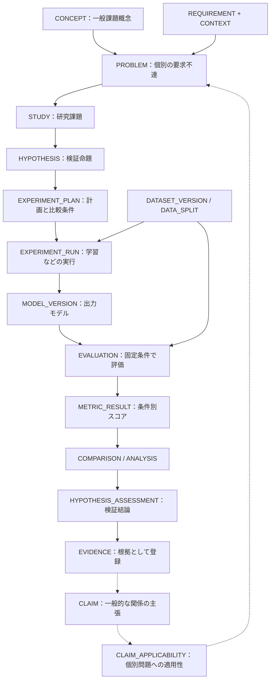
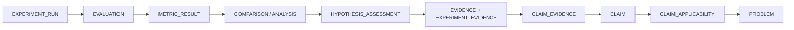
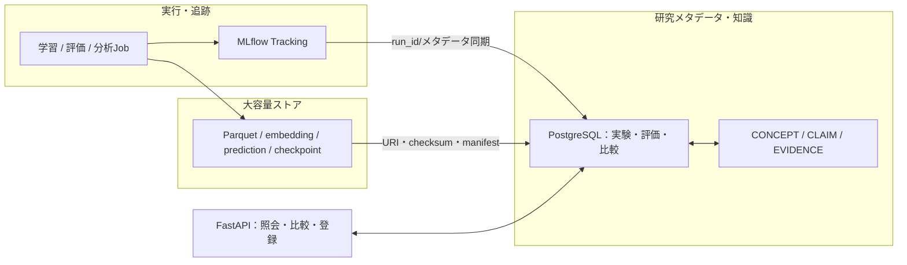

# 実験・評価・比較・分析の論理モデル：詳細リファレンス

**本書の範囲**：実験ドメインのエンティティと制約を定義する。概念と主張の同一性は統合モデル・コアオントロジーに従う。

**識別子の契約**：`concept_id` は分類と独立したUUIDです。概念IDは `../catalog/concepts.yaml` に収録し、論文中の測定値 `PAPER_RESULT` と内製の測定値 `METRIC_RESULT` は別エンティティとして管理します。

## 0. 実験モデルの位置付け

概念レイヤーは、深層学習の**一般的な課題概念**を構造化し、概念間の関係を管理する。実験を蓄積して比較・再評価するには「どのコード・データ・モデル・評価手順で数値が得られたか」「実験で何を操作したか」「どの仮説まで支持できたか」を構造化する必要がある。

**実験サブモデルの中心は `EXPERIMENT_RUN` と `EVALUATION` と `ANALYSIS` の分離**である。

| 区別すべきもの | データモデル上の単位 | 例 |
|---|---|---|
| 一般的な課題 | `CONCEPT`（コア） | OOD汎化困難（`CONCEPT`のUUIDで参照） |
| 個別の要求不達 | `PROBLEM`（コア） | 照明変更後、不良Recallが要求値未満 |
| 研究目的・仮説 | `STUDY` / `HYPOTHESIS` | 精度低下はモデル容量不足より撮影条件の変化で説明できるか |
| 予定した検証 | `EXPERIMENT_PLAN` | 対照群・介入群、共通の評価データ、主要指標 |
| 1回の計算実行 | `EXPERIMENT_RUN` | 乱数42でモデルAを学習 |
| 再利用可能な確定入力 | `DATASET_VERSION` / `DATA_SPLIT` | データv7の固定holdoutセット |
| 確定したモデル成果物 | `MODEL_VERSION` | 学習済み重みのSHA-256とアーティファクト |
| 特定モデル×データ×方式の評価 | `EVALUATION` | モデルv8をholdoutで推論・集計 |
| 条件別の一つの評価結果 | `METRIC_RESULT` | ラインBの不良Recall 0.94 |
| 2つの評価の比較 | `EXPERIMENT_COMPARISON` | ベースラインとデータ拡張のRecall差 |
| 分布・潜在表現・統計の分析 | `ANALYSIS` / `ANALYSIS_FINDING` | 訓練/本番の潜在表現距離、層別の分布差 |
| 仮説の判定 | `HYPOTHESIS_ASSESSMENT` | 支持／非支持／未決着 |
| 一般知識が個別問題に当てはまるか | `CLAIM_APPLICABILITY` | 「Shortcut Learningが要因」という主張の適用性 |
| 論文・実験結果としての根拠 | `EVIDENCE`（コア）＋`EXPERIMENT_EVIDENCE` | 比較結果から作った根拠が`CLAIM`を限定的に支持 |

> 重要：`CONCEPT` の初期215項目と20領域は**不変IDのまま維持する**。実験を追加しても「過学習」の概念IDは増やさない。新しく作るのは個別事例・観測・実験のIDと、その概念へのリンクである。

### 0.1 全体の情報の流れ



矢印は業務フローの概略であって、全てを直接FKで結ぶという意味ではない。実際のエンティティとカーディナリティはPlantUMLを参照。

---

## 1. データモデルの設計原則

1. **概念と実験結果の独立**：`CONCEPT`は知識の用語、`EXPERIMENT_RUN`は出来事、`METRIC_RESULT`は測定の結果、`CLAIM`は関係に関する主張。混ぜない。
2. **単なるRunと評価を区別**：一つのモデルが複数のデータセット・評価プロトコルで評価され、同じ評価を再実行できる。
3. **比較は評価結果を入力とする**：Run同士のスコアを無条件で差し引かない。評価セット・プロトコル・対象スライスが比較可能か確認する。
4. **大容量データは参照して蓄積**：重み、サンプル、予測列、埋め込みはParquetやモデルファイルに保存し、RDBにはアーティファクト参照・スキーマ・チェックサム・統計を保存する。
5. **エビデンスと結論の分離**：観測相関や改善量だけで一般的な因果関係を確定しない。対照、介入、交絡、条件の一致を評価する。
6. **再現性の鍵を固定**：データ版、分割、モデル版、コードcommit、環境、乱数seed、評価手順、しきい値・校正手順、メトリクス定義を固定する。
7. **追加保存・追記優先**：完了済み実験の上書きを避け、再計測・再分析・ラベル訂正は新しい版または新しい測定行にする。
8. **二重の真実を作らない**：MLflowなどの外部トラッカーを利用する場合、どちらをRunの正本とするか明記し、内製DBは外部IDのスナップショットと分析インデックスにする。

---

## 2. エンティティ一覧と1レコードの意味

### 2.1 研究目的・計画

| テーブル | 1レコードの単位 | 主なフィールドと制約 |
|---|---|---|
| `STUDY` | 研究テーマ、調査単位 | `study_id`, title, objective, owner, status |
| `STUDY_PROBLEM` | 研究テーマが扱う具体的問題とのリンク | `(study_id, problem_id)` 複合PK、両側FK |
| `HYPOTHESIS` | 1つの反証可能な仮説 | `hypothesis_id`, `study_id`, statement, null_hypothesis, decision_rule, `target_claim_id?` |
| `EXPERIMENT_PLAN` | 実験プロトコルの固定版 | `plan_id`, `study_id`, `hypothesis_id?`, plan_version, protocol_hash, design_type, prespecified_outcomes, frozen_at |
| `EXPERIMENT_RUN` | 1回のコード実行（学習・評価・分析等） | `run_id`, `plan_id`, `environment_id`, run_kind, seed, config_hash, git_commit, status, started/finished_at, external_tracking_key |
| `ENVIRONMENT_SNAPSHOT` | 1つの環境スナップショット | `environment_id`, runtime_spec_hash, container_digest, Python/CUDA依存情報, hardware_info |
| `INTERVENTION_APPLICATION` | 特定Runで実際に施した変更 | `application_id`, `run_id`, `intervention_id`, baseline_run_id?, config_diff, target_problem_id? |

**`INTERVENTION`（コア）と `INTERVENTION_APPLICATION`（実験ドメイン）の違い**：前者は「Data Augmentationという改善操作の種類」、後者は「今回のRunでBrightness±20%のAugmentationを実施したという履歴」。この分離が、一般論としての改善手法と実験結果を結び付ける要点。

`HYPOTHESIS.target_claim_id` は既存`CLAIM`を検証したい場合にのみ設定する。論文上の一般主張を検証しない探索的な研究も許容する。

### 2.2 バージョン付きデータ・モデルと来歴

| テーブル | 1レコードの単位 | 主なフィールドと制約 |
|---|---|---|
| `DATASET` | 論理データ集合 | `dataset_id`, logical_name, domain, owner |
| `DATASET_VERSION` | 変更不能なデータ集合スナップショット | `dataset_version_id`, dataset_id, version_label, content_hash, manifest_artifact_id, label_schema_hash, frozen_at |
| `DATA_SPLIT` | 変更不能なサンプルID集合 | `split_id`, dataset_version_id, split_name, membership_artifact_id, membership_hash, row_count |
| `DATASET_DERIVATION` | ソース版→派生版の来歴1辺 | `derivation_id`, source_dataset_version_id, derived_dataset_version_id, transform_run_id?, transform_spec_hash |
| `RUN_DATA_USAGE` | どのRunがどの分割をどの用途で読んだか | `(run_id, split_id, usage_role)`、role=`train/validation/reference`など |
| `MODEL_VERSION` | 不変の重み・モデル構成 | `model_version_id`, produced_by_run_id?, weights_artifact_id, model_hash, registry_ref, architecture_spec |
| `ARTIFACT` | 内容ハッシュ付きの外部ファイル・集合 | `artifact_id`, storage_uri, sha256, format, size_bytes, created_at |

**サンプルの会員情報**：`DATA_SPLIT.membership_artifact_id`が参照するParquet/JSON manifestに `sample_id`, `label_snapshot`, `domain`, `time`, `group_id`などを保存する。行単位のラベル管理をSQLでする必要が生じた場合は `SAMPLE`／`LABEL_REVISION`を追加してもよいが、MVPでは予測・埋め込みとともに列指向ファイルを推奨する。

`DATASET_VERSION`はデータ・ラベル・除外対象を含む**内容**で識別する。ラベル修正でも新バージョンを発行する。`DATASET_DERIVATION`で前後を繋ぐ。1バージョンに複数の親があっても良い。

`ARTIFACT.storage_uri` の例：`s3://ml-lake/exp/…`、`file:///mnt/nas/...`。ただし **URIだけでは不変性を保証できない**。読み込むときに `sha256` と manifest 内容を再検証する。大容量ディレクトリは正規化されたファイル一覧のmanifest hashを用いる。

### 2.3 評価値を生み出すテーブル

| テーブル | 1レコードの単位 | 主なフィールドと制約 |
|---|---|---|
| `EVALUATION_PROTOCOL` | しきい値・ラベルの扱い・集計・統計手順の固定版 | `protocol_id`, protocol_hash, label_policy_hash, threshold_policy, confidence_method, evaluator_git_commit |
| `EVALUATION` | （評価実行Run, モデル版, データ分割, 評価プロトコル）の1評価 | `evaluation_id`, run_id, model_version_id, split_id, protocol_id, context_id?, status, evaluated_at |
| `EVALUATION_SLICE` | 1評価における1つの対象集団 | `slice_id`, evaluation_id, slice_key, filter_spec, n_total, n_labeled |
| `METRIC_SPEC_VERSION` | 指標の計算仕様の固定版 | `metric_spec_id`, `metric_id`（既存`METRIC`を参照）, implementation_hash, direction, unit, estimator_spec |
| `METRIC_RESULT` | 1スライス×1指標仕様の結果 | `metric_result_id`, slice_id, metric_spec_id, numeric_value?, result_status, numerator/denominator, count_used, ci_low/high |
| `PREDICTION_SET` | 1評価で出力した予測明細の不変ファイル | `prediction_set_id`, evaluation_id, artifact_id, schema_hash, sample_key_name |

**`METRIC`（コア）と `METRIC_SPEC_VERSION`（実験ドメイン）の違い**：前者は「ECE（期待校正誤差）」などの指標概念、後者は「等幅15bin、サンプル重み、信頼区間の計算法を含むECE計算仕様v2」。`METRIC_RESULT`は仕様版を参照するため、同じ名前の異なる計算方法が混在しない。

**`EVALUATION_SLICE`** により `all`, `line=A`, `line=B`, `is_defect=true`, `lighting=changed`などの条件で精度を切れる。`slice_key`はフィルタの正規化JSONのハッシュとし、別Evaluationで同じスライスを照合できるようにする。`n_total`と`n_labeled`を分離して、正解が存在しない条件ではRecall等を計算しない。

**`METRIC_RESULT.numeric_value=NULL`** を許可するのは「少数クラスが0件でRecall未定義」などを明示するため。**未定義を0として保存してはならない**。`result_status=ok|undefined|insufficient_labels|error` などを必須にする。

### 2.4 比較・仮説・原因分析

| テーブル | 1レコードの単位 | 主なフィールドと制約 |
|---|---|---|
| `EXPERIMENT_COMPARISON` | 2つのEvaluationを比較する設計 | `comparison_id`, study_id, baseline_evaluation_id, candidate_evaluation_id, hypothesis_id?, design_type, comparison_policy, comparability_status |
| `COMPARISON_METRIC_DELTA` | 指標・スライスを揃えた比較結果1件 | `delta_id`, comparison_id, baseline_metric_result_id, candidate_metric_result_id, absolute_delta, ci_low/high, p_value, n_pairs, method_spec |
| `ANALYSIS` | 分布や表現空間などの分析実行 | `analysis_id`, study_id, run_id, analysis_kind, method_spec_hash, status |
| `ANALYSIS_INPUT` | 分析入力の参照（型付きFK）1件 | `analysis_input_id`, analysis_id, role, evaluation_id? / dataset_version_id? / observation_id? / artifact_id?の**いずれか1つ** |
| `ANALYSIS_FINDING` | 分析によって得られた発見1件 | `finding_id`, analysis_id, concept_id?, metric_spec_id?, value?, slice_spec, conclusion_text, uncertainty_spec, artifact_id? |
| `OBSERVATION` | 環境・入力・本番状況の時点・期間観測1件 | `observation_id`, context_id, metric_spec_id?, dataset_version_id?, payload_artifact_id?, numeric_value?, window_start/end, observation_kind |
| `HYPOTHESIS_ASSESSMENT` | 仮説について一度出した検証判定 | `hypothesis_assessment_id`, hypothesis_id, comparison_id?またはanalysis_id?, verdict, decision_reason, assessed_at（比較／分析の参照はちょうど一方） |

`ANALYSIS`は「数値計算をした」という出来事、`ANALYSIS_FINDING`は「計算から得た知見」。両者を分離することで1つの分析Runから多数の発見を収録できる。

`OBSERVATION`と`METRIC_RESULT`は用途が違う。前者はライン照度・生産機種比率・ラベル取得前のドリフトスコアなどの**環境・運用の観測**、後者は固定された評価単位から計算した**モデルの性能指標**。精度を後から評価するときは`EVALUATION`を作り、安易に `OBSERVATION` にRecallを詰めない。

### 2.5 「課題」と「根拠」へ戻す橋

| テーブル | 1レコードの単位 | 役割 |
|---|---|---|
| `PROBLEM_ASSESSMENT` | 要求を特定の測定値で達成判定した履歴 | `problem_id`＋`metric_result_id`＋`evaluated_requirement_id`、要求達成か未達かを保存 |
| `CLAIM_APPLICABILITY` | 既存の一般CLAIMが個別PROBLEMに当てはまるかの判定 | problem_id, claim_id, hypothesis_assessment_id?, status, reason |
| `EXPERIMENT_EVIDENCE` | 既存EVIDENCEを実験由来の一次結果に紐付ける | evidence_id → evaluation / comparison / analysis / hypothesis_assessment の**ちょうど1つ** |

`EVIDENCE`は共通のエビデンス・レコード。`EXPERIMENT_EVIDENCE`は「このエビデンスの実体はどの実験結果か」を型付きFKで示す。`CLAIM_EVIDENCE(stance=supports|refutes|qualifies)` をそのまま利用できる。論文由来EVIDENCEにはこの拡張レコードは不要。

**一般論と局所性を混ぜない**：あるラインの1比較から「データ拡張は全ドメインでショートカット学習を防ぐ」という一般主張を確定しない。通常は`CLAIM_APPLICABILITY`を「this_context_supports / contradicted / not_tested / inconclusive」のように登録し、一般CLAIMへの昇格には外的妥当性の検証を求める。

---

## 3. 最重要：EXPERIMENT_RUN / EVALUATION / METRIC_RESULT / ANALYSISの違い

| 質問 | 見に行くエンティティ | 例 |
|---|---|---|
| 何を実行した？ | `EXPERIMENT_RUN` | モデル学習、評価、統計分析 |
| どんなモデルが出来た？ | `MODEL_VERSION` | モデルの重み・構造とその生成Run |
| モデルを何で測った？ | `EVALUATION` | モデルv2 × Test v1 × 評価プロトコルv3 |
| 何という条件集団で？ | `EVALUATION_SLICE` | 照明変更あり、良/不良、製品群B |
| その指標結果はいくつ？ | `METRIC_RESULT` | Recall 0.94、95% CI=[0.90,0.97] |
| どのモデルが改善した？ | `EXPERIMENT_COMPARISON` + `COMPARISON_METRIC_DELTA` | 同一holdoutのRecall差 +0.035 |
| なぜ差が出た？ | `ANALYSIS` + `ANALYSIS_FINDING` | 撮影条件と潜在表現の変化を調べた結果 |
| その結果から何を結論付ける？ | `HYPOTHESIS_ASSESSMENT` | 仮説を支持、ただしラインBのみに限定 |
| 他の研究で再利用できる知識？ | `EVIDENCE` + `CLAIM_EVIDENCE` | 条件付きの一般主張に対する根拠 |

**例：同じモデルで2つのデータセットを測れば `MODEL_VERSION` は1件、`EVALUATION` は2件**。逆に、同じ評価プロトコルでモデルを2つ測ればEvaluationは2件で、比較は第三の別レコード。

---

## 4. 具体例：ドメインシフトか、モデル容量不足かを切り分ける

具体例として、訓練条件と本番条件がずれた分類タスクのドメインシフトを想定する（説明の都合上、視覚検査の語彙で記述しているだけで、特定ドメインを想定したものではない）：訓練時には照明A、本番では照明B。製品群Bの「不良Recall≥0.99」が要求で、本番で0.94を観測した。

### 4.1 研究課題と仮説

```yaml
study:
  id: ST-illumination-001
  title: 照明変更後の不良Recall低下の原因切り分け
  linked_problem: P-001

hypotheses:
  - id: H-shift
    statement: 精度低下の主因は照明変化に依存する特徴を学習したこと
    null_hypothesis: 照明変化への適応は、評価対象集団で主要指標を改善しない
    target_concept_ids: [ca8dedf6-a227-58c7-9baa-7928ffb9d4dc, 1c6ee4dd-e496-5d78-a499-91cdabf6498c]
  - id: H-capacity
    statement: 精度低下の主因はモデル容量不足である
    null_hypothesis: モデル容量増加は、評価対象集団で主要指標を改善しない

plan:
  dataset_train: ds-train-v7
  dataset_test: ds-holdout-v1     # 固定、テストは学習やハイパーパラメータ選択に使用しない
  primary_outcome: defect_recall
  slices: [all, lighting_changed, lighting_original, product_B]
  seed_policy: [11, 23, 42]
  baselines: [baseline]
  candidates: [augmented, wider_model]
  protocol: metric_spec_and_threshold_version_frozen
```

`H-shift`は「照明が変わった」という入力分布の変化だけでなく、**その変化に依存して性能が落ちるか**を問う仮説である。`H-capacity`は訓練側も含めてモデルの表現不足を検証する。互いに排他的とは限らないため、両方の寄与を調べる交互作用設計がより望ましい。

### 4.2 実験が生むデータの対応

| 段階 | 登録先 | 架空例 |
|---|---|---|
| 固定入力 | `DATASET_VERSION`, `DATA_SPLIT` | Train-v7、Holdout-v1（内容ハッシュ付き） |
| 再現条件 | `EXPERIMENT_PLAN`, `ENVIRONMENT_SNAPSHOT` | seed群、コードcommit、GPU/CUDA、閾値手順 |
| 3モデル×3seedを学習 | `EXPERIMENT_RUN` | Run-001〜009 |
| 学習済み成果物 | `MODEL_VERSION` | Model-001〜009 |
| 共通holdoutで評価 | `EVALUATION` | Eval-001〜009 |
| 条件別の性能 | `EVALUATION_SLICE`, `METRIC_RESULT` | 照明変更群のRecall、ECE、PR-AUC |
| 行単位の予測 | `PREDICTION_SET` | Parquet：sample_id, label, score, pred, domain |
| A/B比較 | `EXPERIMENT_COMPARISON` | baseline vs augmented、baseline vs wider |
| 改善量と不確実性 | `COMPARISON_METRIC_DELTA` | paired bootstrapでRecall差・CI |
| シフト原因分析 | `ANALYSIS`, `ANALYSIS_FINDING` | 入力X、埋め込みZ、ドメインD、ラベルYの分布差 |
| 仮説の検証 | `HYPOTHESIS_ASSESSMENT` | 支持／非支持／未決着＋対象範囲 |
| 既存知識と紐付け | `CLAIM_APPLICABILITY`, `EVIDENCE` | Shortcut Learningの主張がP-001に妥当か |

### 4.3 「分布差」と「モデル不足」を別に分析する

| 分析の問い | 入力・手法の例 | 結果の記録 | 注意点 |
|---|---|---|---|
| `P(X)` が変わった？ | train vs prod の画像統計・二標本検定 | `ANALYSIS_FINDING`, artifact | 分布差だけで精度低下は結論できない |
| `P(D)` が変わった？ | ライン／カメラ／照明などの頻度 | `ANALYSIS_FINDING` | 交絡に注意 |
| `P(Z)` が変わった？ | 固定モデルの埋め込み、MMD等 | `ANALYSIS_FINDING`, embedding artifact | モデルが変わればZの比較空間も変わる |
| `P(Y)` が変わった？ | ラベル付き群でのクラス頻度 | `ANALYSIS_FINDING` | ラベル遅延と選択バイアス |
| Calibrationは崩れた？ | ECE/Brierを環境別に比較 | `METRIC_RESULT`＋`COMPARISON` | 信頼性と精度は別指標 |
| モデルが小さいだけ？ | 同一データ×同一評価で容量増大 | `INTERVENTION_APPLICATION`＋`COMPARISON` | 訓練条件や計算予算を揃える必要 |
| 不良が少なすぎる？ | 支持数・CI、サンプル検査 | `EVALUATION_SLICE`＋`METRIC_RESULT` | Recall 0.94の信頼性は不良件数に依存 |
| 増強が効いた？ | データ拡張の対照実験 | `COMPARISON_METRIC_DELTA` | 結果の汎化範囲は別途確認 |

**因果解釈の注意**：「拡張ありの方が精度が高かった」は介入効果を支持し得るが、それが「ショートカット学習だった」ことの証明ではない。代替経路（正則化、実効データ量、学習安定性）を除外できる設計が必要。

### 4.4 登録例（最小のレコード群）

```yaml
experiment_run:
  run_id: R-001
  plan_id: PLAN-001
  run_kind: training
  seed: 42
  git_commit: "<実際の40文字SHA-1>"
  environment_id: ENV-cuda118
  external_tracking_key: "mlflow://main/experiment-25/run-abc"
  config_hash: "<設定のSHA-256>"
  status: finished

run_data_usage:
  - {run_id: R-001, split_id: train-v7, usage_role: train}
  - {run_id: R-001, split_id: val-v7, usage_role: validation}

model_version:
  model_version_id: M-001
  produced_by_run_id: R-001
  weights_artifact_id: ART-weights-001
  model_hash: "<モデルのSHA-256>"

evaluation:
  evaluation_id: EVL-001
  run_id: R-EVAL-001
  model_version_id: M-001
  split_id: test-unchanged-v1
  protocol_id: EVAL-PROTOCOL-v1

evaluation_slice:
  slice_id: SL-001
  evaluation_id: EVL-001
  filter_spec: {lighting: changed, product: B, label: defect}
  n_total: 300
  n_labeled: 300

metric_result:
  metric_result_id: MR-001
  slice_id: SL-001
  metric_spec_id: recall-v1
  numeric_value: 0.94
  numerator: 282
  denominator: 300
  result_status: ok

problem_assessment:
  problem_id: P-001
  metric_result_id: MR-001
  evaluated_requirement_id: REQ-001
  observed_value: 0.94
  requirement_met: false
```

※UUID型の列については例示を読みやすくするために短い擬似IDを使っている。実データでは実UUIDに置換する。

---

## 5. 「比較できる」とは何か：比較可能性の契約

Runの`train_accuracy=0.98`と別Runの`val_accuracy=0.99`を単純に比較しても意味はない。`EXPERIMENT_COMPARISON`では少なくとも以下を判定して保存する。

| 比較条件 | 判定原則 |
|---|---|
| データ集合・メンバー | 同じ`split_id`を強く推奨。異なるなら比較デザインを明記 |
| 正解ラベルの版 | 同じlabel schema/hashを推奨。ラベル再定義時は原則直接比較不可 |
| 指標定義 | 同じ`metric_spec_id`が基本。仕様が違えばそのまま差分にしない |
| 評価プロトコル | 閾値・後処理・校正・集計手順を一致させる |
| Slice | 正規化filterと母集団の互換性を確認 |
| ペアリング | 同一sample_idで対応が取れる場合だけpaired検定を使用 |
| 乱数 | seed間ばらつき、選択バイアスを明示 |
| 研究計画 | 主要指標・仮説・除外条件が事前に決まっているか |
| 統計的判断 | 効果量・CI・検定方法、必要に応じ多重検定補正を残す |

`comparability_status=compatible|conditional|incompatible`、`comparison_policy`に理由、許容条件、データ重複率、pairing_method、適用した統計手法を保存する。`incompatible`なら`COMPARISON_METRIC_DELTA`の正式承認を止める設計がよい。

### 5.1 差分の定義

同一指標仕様・スライスに対する比較値は、原則

\[
\Delta = \mathrm{Metric}_{candidate} - \mathrm{Metric}_{baseline}
\]

と定義する。ただし**大きいほど良い／小さいほど良い**は `METRIC_SPEC_VERSION.direction` で別管理する。速度・ECEのような低いほど良い指標では、正の\(\Delta\)が改善とは限らない。「改善率」は差分の符号だけで判定しない。

### 5.2 リーク防止

- `train/validation/test`のメンバーシップmanifestに基づき **sample_id**、必要なら **group_id（同一製品・連番フレーム）** 単位で重複検査する。
- モデル・パラメータ・閾値の選択にholdoutを使っていないことを `RUN_DATA_USAGE` と計画から検査する。
- 評価の再実行は許可するが、何度もholdoutを観測して選択を行う場合は、独立した最終テストの再確保が必要。
- `DATASET_VERSION`だけが同一でもサンプル集合が違うことがあるので、評価データの同一性は `DATA_SPLIT.membership_hash` まで比較する。

---

## 6. 実験結果を「知識」に変換する手順

実験の成績表と知識グラフは、役割が異なる。



**必ず残すべき境界**：

- `HYPOTHESIS_ASSESSMENT` はある条件下での検証判定。一般化できる範囲は限定される。
- `EVIDENCE` はその判断に使った実験成果の参照。1つの`EVIDENCE`を複数`CLAIM`に引用できる。
- `CLAIM_EVIDENCE.stance` は論文・実験が主張を**支持・反証・限定**する向き。
- `CLAIM_APPLICABILITY` は一般的な`CLAIM`が個別`PROBLEM`に当てはまるか。*概念間の一般的な因果主張*と*現場の原因の立証*を分離する。

### 6.1 解釈とエビデンスのスコープ

**例**：「照明BのHoldoutで拡張モデルが改善した」という根拠を `EVIDENCE` 化する場合、主張は「このデータ・評価プロトコル・実行範囲内の改善」に制限する。観測データから因果関係を登録する場合は`can_contribute_to`（仮説・条件付き）と`can_cause`（より強い根拠）を区別する。

---

## 7. 実装アーキテクチャ：RDB・MLflow・ファイル／オブジェクトストア

推奨構成は既存のFastAPIやMLflow等に接続しやすい、**RDBが正規化されたメタデータ、MLflowがRun取得元、Parquet/オブジェクトストアが大容量データ、課題オントロジーが知識索引**という分業。MLflowのRun、メトリクス、パラメータ、artifactは公式に追跡できる。<https://mlflow.org/docs/latest/ml/tracking/>



### 7.1 何をどこへ保存するか

| データ | 保存先の基本方針 | 理由 |
|---|---|---|
| Study / Hypothesis / Experiment Plan | 独立RDB | MLflow Runでは表しにくい研究計画と仮説の関係 |
| Run parameters / timestamps | MLflowを正本とし、RDBに正規化スナップショット | 実行ライフサイクルと比較可能検索の両立 |
| 指標のログ（各step） | MLflowまたは時系列ストア | 学習曲線のような大量のイベント |
| 確定した評価値・Slice集計 | `METRIC_RESULT`（RDB） | 条件を揃えたSQL比較・閾値判定 |
| 訓練データ・予測・埋め込み | version付きデータレイク/Parquet | 行数・サイズが大きい |
| アーティファクトURIとハッシュ | `ARTIFACT`（RDB） | 再現性と参照整合性 |
| 一般的な課題分類と一般関係 | `CONCEPT` / `CLAIM`（コア） | 一次概念の不変性とエビデンスの整理 |
| 本番データ品質・環境の観測 | `OBSERVATION`＋必要なら時系列DB | ラベル遅延や観測時刻に対応 |

**運用上の注意**：MLflow自体もBackend DBとArtifact Storeを持つが、内部スキーマに直接依存して拡張しない。公式API／エクスポートから同期し、`external_tracking_key`（Tracking server + Experiment + Runの組）で冪等にupsertする。同期時の取得時刻、Run終端状態、元レスポンスのhashを監査用に記録することが望ましい。<https://mlflow.org/docs/latest/api_reference/rest-api.html>

### 7.2 外部標準・ツールとの概念上の接続

- **W3C PROV-O**：`EXPERIMENT_RUN/ANALYSIS`を`Activity`、`DATASET_VERSION/MODEL_VERSION/ARTIFACT`を`Entity`、実行者を`Agent`に写像できる。`used`、`wasGeneratedBy`、`wasDerivedFrom`の概念と整合する。<https://www.w3.org/TR/prov-o/>
- **OpenLineage**：dataset/job/runのモデルとfacetsを用いた実行系来歴の収集に接続可能。今回の`HYPOTHESIS`/`CLAIM`はその上位の研究意味論として別に保持する。<https://openlineage.io/docs/next/>
- **MLflow**：Run、パラメータ、メトリクス、Artifactを外部参照し、研究上の比較・課題概念のリンクは内製DB側で増補する。<https://mlflow.org/docs/latest/ml/tracking/>

これらは*概念的な対応*であり、ER図だけでデータ交換仕様が実装済みになるわけではない。

---

## 8. 実装時に必須となる整合性ルール

| 優先 | 対象 | 必要な制約 |
|---|---|---|
| MUST | `EXPERIMENT_RUN` | `plan_id`などのFK、status enum、外部Tracking Run参照の一意性（サーバ識別子込み） |
| MUST | `DATASET_VERSION`, `DATA_SPLIT`, `MODEL_VERSION` | 内容ハッシュ、一度公開した内容の不変性、改訂時の新ID発行 |
| MUST | `DATASET_DERIVATION` | 自己参照禁止、循環検知、ソース/派生のFK |
| MUST | `ANALYSIS_INPUT` | `evaluation_id / dataset_version_id / observation_id / artifact_id` の非NULL数が1 |
| MUST | `HYPOTHESIS_ASSESSMENT` | `comparison_id`と`analysis_id`のうち正確に1つだけを参照（どちらにも属さない独立判断を許す場合は別の判定由来型を定義） |
| MUST | `EXPERIMENT_EVIDENCE` | `evaluation_id / comparison_id / analysis_id / hypothesis_assessment_id` の非NULL数が1 |
| MUST | `METRIC_RESULT` | `result_status=ok`なら値必須、`undefined`なら値NULL。`count_used>=0`、`ci_low<=ci_high` |
| MUST | `EVALUATION_SLICE` | `(evaluation_id,slice_key)`は一意。`0<=n_labeled<=n_total` |
| MUST | `EXPERIMENT_COMPARISON` | baselineとcandidateが異なる。比較契約を満たすまで正式承認しない |
| MUST | `COMPARISON_METRIC_DELTA` | 2つの結果が比較表の両Evaluationに属する。指標仕様とスライス定義の一致または明示的な例外 |
| MUST | `PROBLEM_ASSESSMENT` | `PROBLEM.requirement_id` と evaluated_requirement_idの一致（要求改訂を版管理する場合はsnapshot必須） |
| MUST | `CLAIM`/`EVIDENCE` | 実験結果から因果を自動で断定しない、成立条件・証拠の対象文脈を残す |
| SHOULD | `MODEL_VERSION` | 生成元Runとモデルartifactの整合性、SHA-256確認 |
| SHOULD | `DATA_SPLIT` | train/val/testのgroup leakageを検査、Holdoutへの過剰適合も監査 |
| SHOULD | 全重要行 | `created_at`, `created_by`, `schema_version`, `review_status` 等の監査列 |

**DDL実装上の補足**：FKだけでは`METRIC_RESULT`から辿ったEvaluationが`COMPARISON`に指定したEvaluationと一致することや、`CLAIM`の排他的サブタイプの完全性は保証できない。制約トリガー、遅延制約、またはトランザクション境界で検証する。`EXPERIMENT_EVIDENCE`の`EVIDENCE.evidence_kind`との整合性も別途保証する。

### 8.1 実際に発生しやすい設計上の誤り

- `RUN.metric_name = 0.94` として単一スカラーに押し込む → データ条件、クラス、閾値が不明になり比較不能。
- データ版を`latest`で参照する → 後で再現できない。固定VersionとHashが必要。
- 新しいラベル付けを同じデータ版で上書き → 過去のRecallが変わる。ラベル版込みでVersion化。
- `EVIDENCE`へ実験の全文を複製 → 同一結果の更新不整合。元の実験レコードを参照する。
- `CLAIM`を確率0.8のような単純な真偽値で持つ → 条件・反例・研究品質を表現できない。
- `P(X)`の差から性能悪化の原因を断定 → 変化が無害な場合もある。性能、ラベル、交絡の検証が必要。

---

## 9. 分析・問い合わせビュー例（設計が満たすべきユースケース）

| 質問 | 主に結合するもの | 出したいもの |
|---|---|---|
| この製品群で最近精度が落ちた？ | `PROBLEM`, `PROBLEM_ASSESSMENT`, `METRIC_RESULT`, `EVALUATION_SLICE`, `EVALUATION` | 要求との差、発生日、モデル版・データ版・条件 |
| Augmentationで改善した？ | `INTERVENTION_APPLICATION`, `EXPERIMENT_RUN`, `MODEL_VERSION`, `EVALUATION`, `EXPERIMENT_COMPARISON` | 同一条件下の改善量、CI、seed間分散 |
| 照明変更は表現に影響した？ | `ANALYSIS`, `ANALYSIS_INPUT`, `ANALYSIS_FINDING`, 埋め込みartifact | モデル固定のZ距離、サンプル群ごとの違い |
| 不良クラスのRecallとECEを比較したい | `EVALUATION_SLICE`, `METRIC_RESULT`, `METRIC_SPEC_VERSION` | クラス・照明別の指標と支持数 |
| この問題に対して何が効果的だった？ | `PROBLEM`, `CLAIM_APPLICABILITY`, `CLAIM`, `INTERVENTION_EFFECT`, `EXPERIMENT_COMPARISON` | 一般候補と自社実験での結果を分離して表示 |
| どの論文主張が自社実験で再現された？ | `CLAIM`, `CLAIM_EVIDENCE`, `EXPERIMENT_EVIDENCE`, `HYPOTHESIS_ASSESSMENT` | 支持／反証／限定、再現条件、反例 |
| このスコアを完全に再現したい | `METRIC_RESULT`→`EVALUATION`→`MODEL_VERSION`/`DATA_SPLIT`/`EVALUATION_PROTOCOL`→`EXPERIMENT_RUN` | 重み、評価データ、実行コード・環境・seed |

### 9.1 RDB内に最低限持つべき検索用インデックス

- `METRIC_RESULT(slice_id, metric_spec_id)`および `(metric_spec_id, numeric_value)`
- `EVALUATION(model_version_id, split_id, protocol_id)`
- `EVALUATION_SLICE(evaluation_id, slice_key)` 一意
- `EXPERIMENT_RUN(plan_id, status, started_at)`、`external_tracking_key` 一意
- `RUN_DATA_USAGE(split_id, usage_role)`
- `ANALYSIS_FINDING(analysis_id, concept_id)`
- `CLAIM_APPLICABILITY(problem_id, claim_id)`

---

## 10. 境界を明示した段階的実装

| 段階 | 追加するもの | 得られる機能 |
|---|---|---|
| **Phase 1：再現可能な実験台帳（MVP）** | `STUDY`, `EXPERIMENT_PLAN`, `EXPERIMENT_RUN`, `ENVIRONMENT_SNAPSHOT`, `DATASET`, `DATASET_VERSION`, `DATA_SPLIT`, `RUN_DATA_USAGE`, `MODEL_VERSION`, `ARTIFACT`, `EVALUATION_PROTOCOL`, `EVALUATION`, `EVALUATION_SLICE`, `METRIC_SPEC_VERSION`, `METRIC_RESULT`, `PREDICTION_SET` | MLflow連携、どのデータ/モデル/指標か追跡、条件別比較の土台 |
| **Phase 2：比較・施策の評価** | `HYPOTHESIS`, `STUDY_PROBLEM`, `INTERVENTION_APPLICATION`, `EXPERIMENT_COMPARISON`, `COMPARISON_METRIC_DELTA`, `PROBLEM_ASSESSMENT`, `DATASET_DERIVATION` | 対照実験、効果量とCI、要求達成判定、因果の検証設計 |
| **Phase 3：原因分析と知識蓄積** | `OBSERVATION`, `ANALYSIS`, `ANALYSIS_INPUT`, `ANALYSIS_FINDING`, `HYPOTHESIS_ASSESSMENT`, `CLAIM_APPLICABILITY`, `EXPERIMENT_EVIDENCE` | P(X)/P(Z)/P(D)/P(Y)、ECE分析、仮説の判定、知識グラフへの証拠還元 |
| **Phase 4：運用高度化** | アノテーション単位履歴、追加の再学習トリガ、自動実験計画、統計多重比較制御、因果DAG。承認・監査はガバナンス領域で管理 | 継続運用・高度な原因診断とガバナンス |

### 10.1 まだ定義していないものと今後の判断点

1. **SAMPLE・LABELレベルのRDBスキーマ**：サンプル単位のアノテーション履歴と可変ラベル承認をDBに持つなら追加が必要。現時点はファイルmanifestと外部アノテーション基盤に委ねる。
2. **Experiment Planの事前登録・改訂手順**：`frozen_at`前は編集可能、以降は新`plan_version`。その承認者や監査証跡は別テーブルで拡張する。
3. **オンライン監視のイベント時系列**：大量イベントは別ストアが適する。`OBSERVATION`は集約／リンク中心。
4. **交絡を含む因果推論モデル**：介入・比較という記録だけでは因果関係は保証しない。ランダム化、マッチング、負の対照、差の差などの採用理由も保存する。
5. **研究メタデータの名称の一意性と分割統合**：`DATASET`, `MODEL_VERSION`, `CONCEPT`に別々の識別体系を用いる。概念IDは分類から独立したUUIDとする。

---

## 11. PlantUML ER図の読み方

同梱 `../diagrams/knowledge_research_er.puml` には **10枚の独立した図** があり、実験系は `MODEL_09_Experiment_Core` と `MODEL_10_Data_Model_and_Evaluation` を重点参照します。複数図で同一テーブル名が登場しても、参照のための投影であり物理テーブルが重複するものではありません。

### 概念・実験モデルの接続

- `PROBLEM`, `CLAIM`, `EVIDENCE`, `CONCEPT` 等の概念層は `../ontology/03_core_ontology_reference.md` が正本です。
- `INTERVENTION` は改善操作の辞書、`METHOD` は方法／アルゴリズムの辞書。多対多の `INTERVENTION_METHOD` で紐付けます。
- `EXPERIMENT_RUN` の `run_id` はUUID。`MLflow Run ID` と同じものとはせず、外部識別子を別フィールドで保持します。
- `METRIC_RESULT` と `PAPER_RESULT` は評価プロトコルが一致する場合でも別レコード。比較結果は横断ビューで導出します。
- 本モデルは論理ERです。実DBのUUID FK、チェック制約、トランザクション、索引の実装は別途必要です。

## 付記：運用時の比較整合性

`COMPARISON_METRIC_DELTA`に指定する両側の `METRIC_RESULT` は、対応する `EXPERIMENT_COMPARISON` のbaseline/candidate `EVALUATION`にそれぞれ属することを検証する。さらに `metric_spec_id` と `slice_key` の一致（または承認された互換変換）、母集団・ラベル版・閾値方針の一致を検査する。満たさない組を暗黙に差し引かない。詳細は [`../design/06_integrity_and_model_contracts.md`](../design/06_integrity_and_model_contracts.md)。
